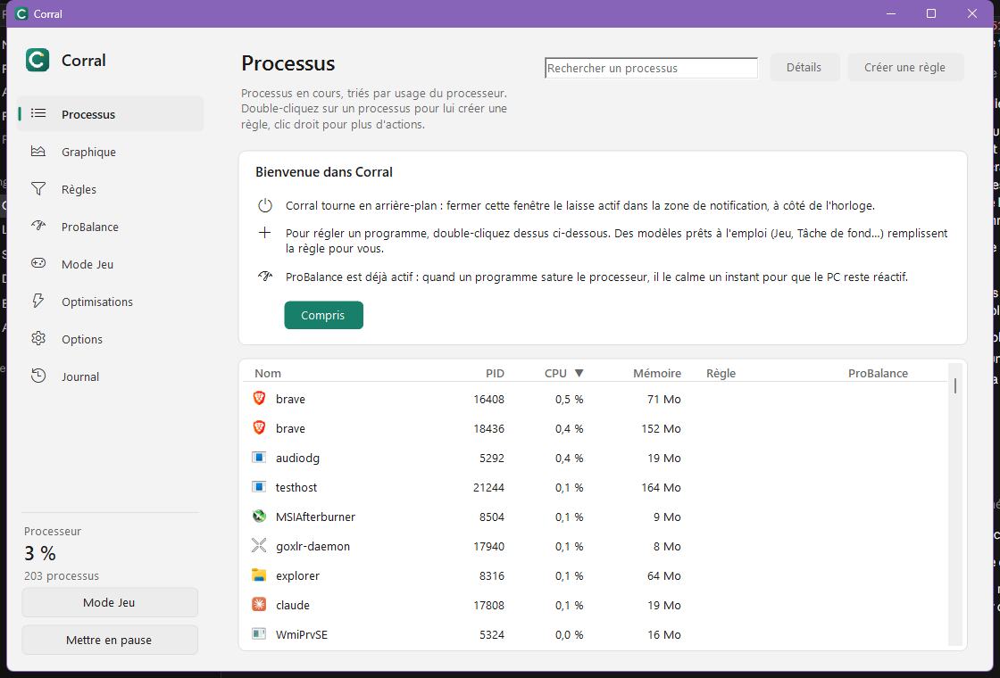

# Corral

{ align=right width=96 }

**Corral** est un gestionnaire de processus libre et gratuit pour Windows 10 et 11, alternative open source à Process Lasso.
Il garde le PC réactif quand un programme accapare le processeur, applique vos règles à chaque lancement d'un programme
et remet tout comme avant quand il s'arrête.

[Télécharger la dernière version](https://github.com/Captain-VII/Corral/releases/latest){ .md-button .md-button--primary }
[Installation](installation.md){ .md-button }

## Ce que fait Corral

- **Règles par application** : priorité, cœurs du processeur, plan d'alimentation, plafonds de CPU et de mémoire, mode efficacité, carte graphique… éventuellement seulement sur batterie, à certaines heures ou certains jours. Voir [Règles](utilisation/regles.md).
- **ProBalance** : abaisse le temps qu'il faut les programmes qui saturent le processeur ; la fenêtre que vous utilisez n'est jamais touchée. Voir [ProBalance](utilisation/probalance.md).
- **Mode Jeu** : plan Performances, programmes de fond calmés, automatiquement quand un jeu tourne. Voir [Mode Jeu](utilisation/mode-jeu.md).
- **Surveillance** : CPU, mémoire, disque et GPU par programme, graphiques, journal.
- **Entreprise** : installation MSI avec service Windows, stratégies de groupe, configuration de parc signée, ligne de commande et PowerShell, équité entre les sessions sur les serveurs RDS. Voir [Administration](admin/deploiement.md).

Tout ce que Corral modifie est restauré à la fermeture, en pause et après un plantage.

## Libre et gratuit

Corral est sous licence [GPL-3.0](https://github.com/Captain-VII/Corral/blob/main/LICENSE) : vous pouvez l'utiliser partout, y compris en entreprise, l'étudier et le modifier.
Les questions, idées et rapports de bug sont les bienvenus sur [GitHub](https://github.com/Captain-VII/Corral/issues).
