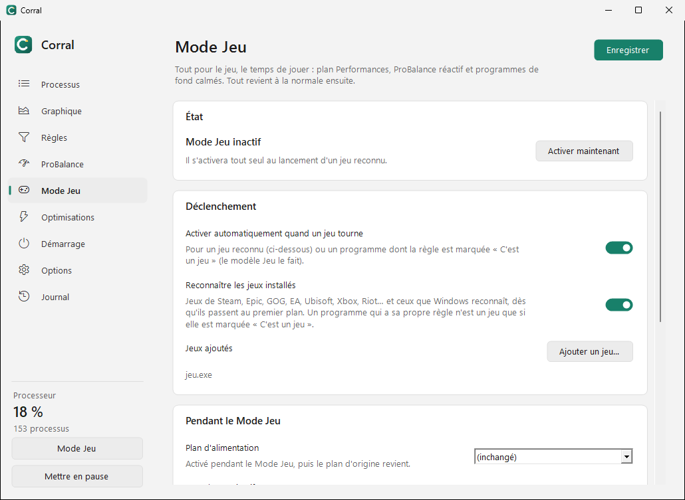

# Mode Jeu

Le Mode Jeu met le PC en condition pour jouer, puis remet tout comme avant :

- **plan d'alimentation Performances** (ou celui de votre choix) ;
- **ProBalance réactif** ;
- **programmes de fond calmés** (navigateurs, OneDrive, lanceurs…) : priorité basse et mode efficacité.

## Activation

- **Automatique** : dès qu'un jeu reconnu passe au premier plan, ou qu'un programme dont la règle est marquée *C'est un jeu* tourne (modèle **Jeu** de la fenêtre de règle).
- **Manuelle** : bouton **Mode Jeu** de la fenêtre, menu de l'icône de notification, ou raccourci ++ctrl+alt+g++.

Une bulle prévient à l'activation et à la désactivation (désactivable).

## Jeux reconnus tout seuls

Avec l'option **Reconnaître les jeux installés** (activée par défaut), un jeu n'a pas besoin de règle :

- les jeux des bibliothèques **Steam** (sur tous les disques), **Epic**, **GOG**, **EA**, **Ubisoft**, **Xbox**, **Riot**, **Rockstar**, **Amazon** et **itch.io** ;
- les jeux installés ailleurs que dans le dossier par défaut, d'après **Epic**, **GOG Galaxy**, **Ubisoft Connect** et **EA** ;
- les jeux que **Windows** a reconnus (Game Bar), où qu'ils soient installés : Battle.net, jeux autonomes…

Les lanceurs, rapports de plantage, installeurs, anti-triche et logiciels vendus sur Steam qui ne sont pas des jeux (Wallpaper Engine, Lossless Scaling…) sont écartés.

Un jeu reconnu active le Mode Jeu quand il passe **au premier plan**, et le garde tant qu'il tourne et qu'il a été au premier plan dans les **10 dernières minutes** : un logiciel de fond rangé dans une bibliothèque de jeux ne l'active donc pas. Un jeu (reconnu ou marqué) n'est jamais abaissé par ProBalance, même en arrière-plan.

Un programme pris pour un jeu à tort ? Créez-lui une règle sans cocher *C'est un jeu* : une règle a toujours le dernier mot. Avec le service, la reconnaissance se fait pour l'utilisateur dont l'interface est ouverte.

## Ajouter un jeu à la main

Pour un jeu que Corral ne reconnaît pas (émulateur, jeu Java…), **Ajouter un jeu…** crée une règle marquée *C'est un jeu* : le Mode Jeu s'active dès qu'il tourne, au premier plan ou non.

## Programmes de fond

La liste des programmes calmés se modifie sur la page Mode Jeu. Un programme qui a sa propre règle n'est pas concerné.
