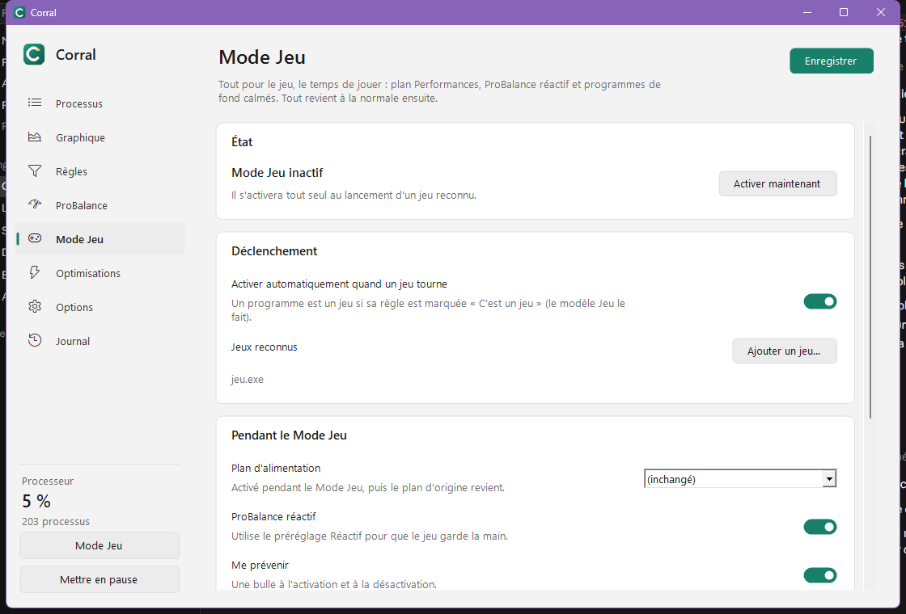

# Mode Jeu

Le Mode Jeu met le PC en condition pour jouer, puis remet tout comme avant :

- **plan d'alimentation Performances** (ou celui de votre choix) ;
- **ProBalance réactif** ;
- **programmes de fond calmés** (navigateurs, OneDrive, lanceurs…) : priorité basse et mode efficacité.

## Activation

- **Automatique** : dès qu'un programme dont la règle est marquée *C'est un jeu* tourne (modèle **Jeu** de la fenêtre de règle).
- **Manuelle** : bouton **Mode Jeu** de la fenêtre, menu de l'icône de notification, ou raccourci ++ctrl+alt+g++.

Une bulle prévient à l'activation et à la désactivation (désactivable).

## Programmes de fond

La liste des programmes calmés se modifie sur la page Mode Jeu. Un programme qui a sa propre règle n'est pas concerné.
