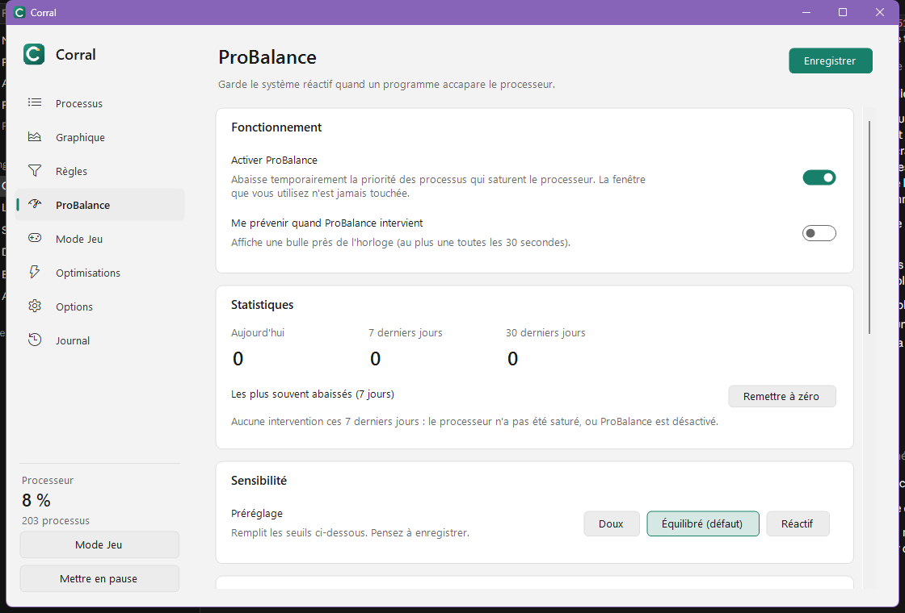

# ProBalance

Quand le processeur est saturé, ProBalance abaisse temporairement la priorité des programmes qui en prennent le plus,
pour que la fenêtre que vous utilisez reste fluide. Leur priorité d'origine leur est rendue dès que le système se calme.

## Ce qui n'est jamais touché

- la fenêtre au premier plan ;
- les processus système de Windows ;
- les programmes qui ont une règle de priorité ;
- les programmes de la liste **Exclusions** (jokers acceptés).

## Sensibilité

| Préréglage | Charge du processeur | Charge d'un programme | Délai avant d'agir |
|---|---|---|---|
| Doux | 85 % | 10 % | 5 s |
| Équilibré (défaut) | 75 % | 5 % | 3 s |
| Réactif | 60 % | 3 % | 2 s |

Pendant le [Mode Jeu](mode-jeu.md), ProBalance passe en *Réactif* si l'option est activée.

## Statistiques et notifications

La page indique combien de fois ProBalance est intervenu et quels programmes il abaisse le plus souvent.
L'option **Me prévenir** affiche une bulle à chaque intervention (au plus une toutes les 30 secondes).

## Équité entre les sessions

Sur un serveur RDS ou un VDI multi-session, voir [Serveurs RDS / VDI](../admin/rds.md).
