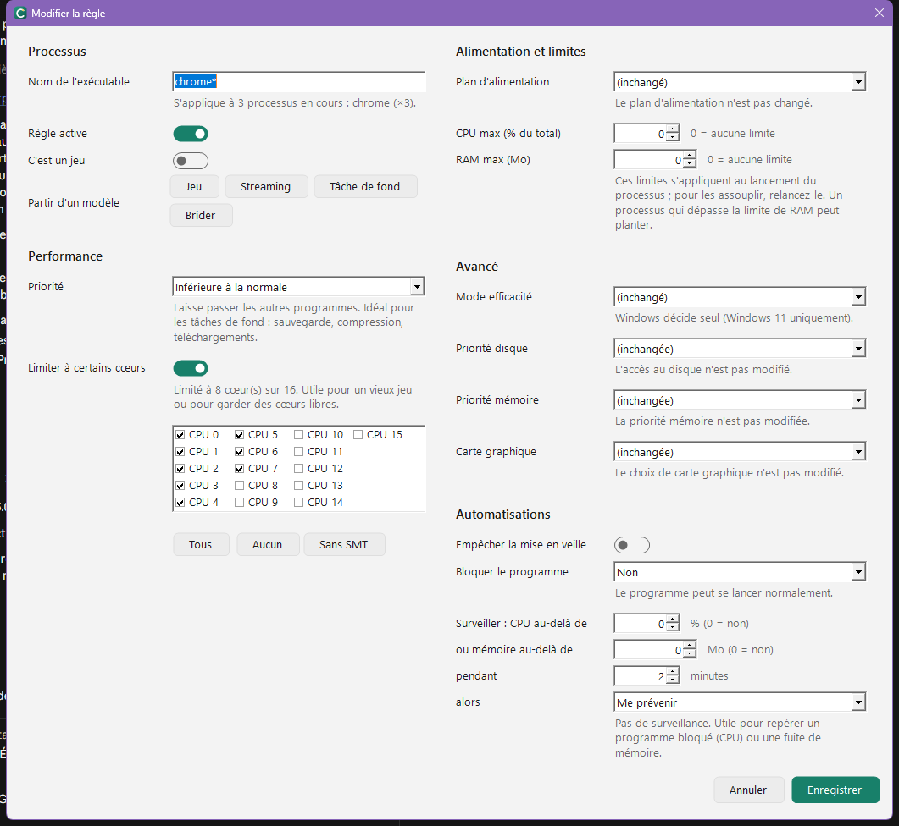

# Règles

Une règle s'applique à chaque programme dont le nom correspond, dès son lancement. Créez-en une depuis la page **Règles** (**Nouvelle règle**, ++ctrl+n++),
ou par un double-clic sur un programme de la page **Processus**.

## Nom du programme

Le nom de l'exécutable, avec ou sans `.exe`. Les jokers sont acceptés : `chrome*` vise `chrome.exe` et `chromedriver.exe`.
Sous le champ, Corral indique combien de programmes en cours sont concernés. Les processus système de Windows ne sont jamais modifiés.

Si plusieurs règles correspondent, c'est la première de la liste qui s'applique.

## Modèles

| Modèle | Effet |
|---|---|
| Jeu | Priorité haute, marqué comme jeu (déclenche le [Mode Jeu](mode-jeu.md)), plan Performances s'il existe |
| Streaming | Priorité supérieure à la normale, jamais en mode efficacité |
| Tâche de fond | Priorité inférieure à la normale |
| Brider | Priorité inférieure à la normale et 25 % du processeur au maximum |

## Réglages

- **Priorité** : de *Inactive* à *Haute*. *Haute* convient à un jeu, pas à un programme qui tourne en permanence.
- **Cœurs** : limite le programme à certains cœurs. Corral propose des choix adaptés au processeur (cœurs performants, CCD avec V-Cache, sans SMT).
- **Plan d'alimentation** : activé tant que le programme tourne, puis le plan d'origine revient.
- **CPU max et RAM max** : plafonds stricts, appliqués au lancement du programme.
- **Mode efficacité, priorités disque et mémoire, carte graphique** : réglages avancés de Windows 11.
- **Automatisations** : empêcher la mise en veille, bloquer le programme (ou n'en autoriser qu'une instance), surveiller sa consommation et prévenir, abaisser ou fermer au-delà d'un seuil.

## Conditions

Une règle peut ne s'appliquer que :

- **sur secteur** ou **sur batterie** ;
- **entre deux heures** (la plage peut passer minuit : de 22:00 à 06:00) ;
- **certains jours** de la semaine.

Quand la condition cesse d'être remplie, Corral annule les effets de la règle ; ils reviennent quand elle l'est de nouveau.

!!! example "Exemple"
    Une sauvegarde en priorité basse et limitée à 25 % du processeur **en journée, en semaine**, et libre la nuit et le week-end.

## Profils, import et export

Plusieurs jeux de règles (Travail, Jeu, Silencieux…) peuvent coexister : un seul est actif, à choisir depuis la page Règles ou l'icône de notification.
Le menu **⋯** de la page Règles exporte et importe les règles dans un fichier JSON.
